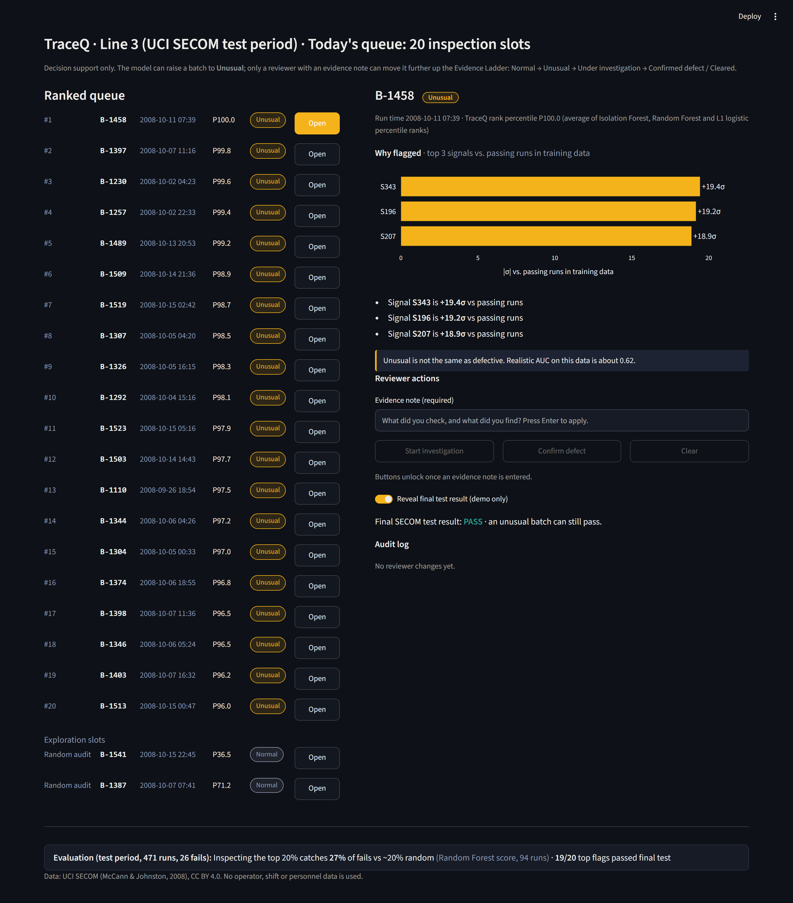

# TraceQ: Quality Intelligence prototype

**BUILD2RISE 2026, Problem Statement 5: Quality Intelligence System**

TraceQ is decision support for factory quality teams. It ranks production batches by investigation priority and explains why each one is flagged. It follows the **Evidence Ladder**:

`Normal → Unusual → Under investigation → Confirmed defect / Cleared`

The model can raise a batch to **Unusual** at most. Only a human reviewer can move a batch further, and they have to enter an evidence note to do so. The app never labels a batch "defective" by itself.



## Run the app

```bash
pip install -r requirements.txt
streamlit run app.py
```

The first load fits the models in about 20 seconds; after that they are cached. Open `/?view=strip` for the compact layout used in the slide card.

## What's in the repo

| Path | What it is |
|---|---|
| `app.py` | Streamlit app: ranked queue, Why-flagged panel, reviewer actions with an audit log, evaluation strip |
| `analysis/secom_analysis.py` | Time-split evaluation of the three models and the TraceQ blend → `results.json` |
| `analysis/secom_extra.py` | Random-split CV vs time split, walk-forward retraining, SPC rule baseline → `extra.json` |
| `data/` | UCI SECOM dataset (see below) |
| `screenshots/` | App screenshots |

To regenerate the analysis numbers:

```bash
python analysis/secom_analysis.py data analysis/results.json
python analysis/secom_extra.py data analysis/extra.json
```

## Method
- **Time-ordered split.** Runs are sorted by timestamp. The models train on the earliest 70% (1,096 runs) and are tested on the latest 30% (471 runs, 26 fails), which simulates scoring future batches.
- **Preprocessing (train split only).** Columns that are more than 50% missing or constant are dropped. Values are median-imputed, standard-scaled and clipped to ±10.
- **TraceQ score.** The mean of the percentile ranks from an Isolation Forest (fitted on passing runs only), a Random Forest and an L1 logistic regression.
- **Why flagged.** The top 3 signals by |z| against passing training runs.
- **Evaluation strip.** Uses the static Random Forest from `secom_extra.py`. Inspecting the top 20% catches 27% of fails, against about 20% for random inspection, and 19 of the 20 top flags passed final test. Realistic AUC on this data is about 0.62, so a flag means *unusual*, not *defective*.

The app uses no operator, shift or personnel data and no material-lot data.

## Data
UCI SECOM dataset: McCann, M. & Johnston, A. (2008). *SECOM* [Dataset]. UCI Machine Learning Repository. https://doi.org/10.24432/C54305. Licensed under [CC BY 4.0](https://creativecommons.org/licenses/by/4.0/). The files in `data/` are included unmodified.
